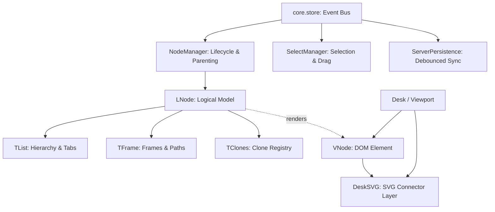

# Architecture Overview: a-nodes

Системная архитектура пространственного аутлайнера **a-nodes** — бесконечной визуальной доски со структурированными иерархическими списками, синхронизированными клонами и фреймами.

Связанные документы:
- [GLOSSARY.md](file:///d:/_sites/a-node(v.AI)/GLOSSARY.md) — терминология доменной модели (!фрейм, !группа, !подфрейм, !клон).
- [docs/PROJECT_CONTEXT.md](file:///d:/_sites/a-node(v.AI)/docs/PROJECT_CONTEXT.md) — компактная выжимка для AI-ассистента.
- [docs/ANALYSIS_REPORT.md](file:///d:/_sites/a-node(v.AI)/docs/ANALYSIS_REPORT.md) — аудит, рекомендации улучшений и roadmap.

---

## 1. Структура монорепозитория (Workspace Layout)

Проект организован как `npm workspaces` с внешним субмодулем:

```
a-nodes/
├── client/          # Frontend: Vite + TypeScript + SCSS (Vanilla TS UI, SVG Canvas)
├── server/          # Backend: Node.js, Express 5, MongoDB (Mongoose), Telegraf
├── shared/          # Общие типы данных и упаковщики битовых масок (INodeDB, ILNode)
├── _base/           # Git-субмодуль: Router, EventEmitter, базовые SCSS-иконки
├── docs/            # Аналитика, архитектурный контекст и отчёты
└── .tasks/          # Трекер текущих проектных задач (..task)
```

---

## 2. Клиентский слой (`client/src`)

Клиент построен без тяжелых UI-фреймворков для достижения предельной производительности при манипуляции тысячами узлов на бесконечном холсте.



### 2.1. Разделение модели и представления (Model-View)
- **`LNode`** (`features/nodes/LNode/`):
  - Чистая логическая модель узла: координаты `x, y`, уникальный `lID`, заголовок, состояние скрытости (`hidden`, `hiddenBD`).
  - Композиция компонентов:
    - `TList`: древовидные связи (`parentLID`, `children`, уровень таба `tab`, порядок `index`).
    - `TFrame`: режим фрейма (`isFrame`), списки родительских и дочерних фреймов, перерисовка SVG-связей.
    - `TClones`: реестр клонов узла (`mainNode`, `sourceNode`, `nodes`).
    - `TRepeatMode`: правила повторения задач и вычисление даты следующего показа.
- **`VNode`** (`features/nodes/VNode/`):
  - Графический контроллер и DOM-элемент (`div.vNode`).
  - Обработка `pointerdown`, `pointermove`, `pointerup`, double click.
  - Интеграция в SVG-слой: рендер фоновых прямоугольников и соединительных кривых Безье (`Ge_Path`).
  - Специализации: `VTextEdit` (contenteditable инпут, кнопки питания клонов), `VTextEditClone` (отображение пути родителей), `VPage` (ссылка на поддоску).

### 2.2. Пространственная математика и сетка (`Desk & Viewport`)
- Холст поддерживает бесконечное панорамирование и зум через CSS Transform (`translate(x, y) scale(s)`).
- `GRID.x = 50px`: горизонтальный шаг отступа уровней дерева.
- `TList.setPositionForChildren()`:
  - Координата $X$: $x = x_{owner} + GRID.x \times tab$.
  - Координата $Y$: рассчитывается кумулятивным суммированием фактических высот DOM-элементов (`vNode.height`).
  - Атрибут `data-totaltab` динамически управляет размером шрифта и шириной текста через CSS-переменные: `calc(var(--f-font-size-start) - var(--f-font-step) * var(--n))`.

---

## 3. Слой хранения и битовая сериализация (`shared & DB`)

### 3.1. Принципы хранения данных
- **Максимальная ёмкость**: запрещено раздувать схему ноды новыми полями первого уровня. Все малые переменные (булевы флаги, перечисления, статусы, небольшие числа) обязательно упаковываются в битовые маски через класс `TPackedData<T>` в уже существующие агрегирующие поля (`s`, `L`, `A`, `D`).
- **Обязательное согласование**: перед добавлением любого нового свойства или статуса в модель узла строго обязательно уточнять у пользователя/архитектора, в какое именно упакованное поле и в каком битовом формате сохранять новое свойство.

### 3.2. Битовые маски `TPackedData<T>`

| Поле в `INodeDB` | Назначение | Упакованные параметры |
| :--- | :--- | :--- |
| **`s`** (Status) | Идентификация и статусы списков | `lID` (17 бит), `isFrame` (1 бит), `hiddenBD` (1 бит), `isListClosed` (1 бит, инвертирован: 0 = открыт по умолчанию), `isRepeatsOpen` (1 бит), `isHiddenOpen` (1 бит) — суммарно 22 бита из 31/32 |
| **`L`** (List) | Дерево и позиция | `tab` (3 бита), `index` (12 бит), `parentLID` (17 бит) |
| **`A`** (Clones) | Связи клонов | `mainNodeLID` (17 бит) |
| **`D`** (Dates) | Повторы и даты | `repeatMode` (3 бита), `daysFromStartDay` (13 бит от `2026-10-13`) |
| **`f`** | Массив родителей | `number[]` (`parentsLID` для фреймов) |

---

## 4. Серверный слой (`server/src`)

- **Архитектура**: REST API на Express 5 с Mongoose.
- **Маршруты (`routes/`)**:
  - `/api/auth`: Google OAuth 2.0 верификация токенов, генерация сессионных JWT и Refresh-токенов.
  - `/api/users`: управление профилем и настройками пользователя.
  - `/nodes`:
    - `GET /nodes/:nodeId` — выборка нод текущей доски (страницы) с исключением удаленных.
    - `PUT /nodes/saveNodes` — пакетный upsert через `Node.bulkWrite()`.
    - `DELETE /nodes/:id` — удаление узла.
- **Фоновые сервисы**:
  - `bot.ts` — Telegram бот на базе `telegraf` (интеграция уведомлений и напоминаний).

---

## 5. Потоки данных (Data Flows)

### 5.1. Жизненный цикл редактирования и синхронизации
```
[User Drag / Edit]
       │
       ▼
   [VNode DOM Event]
       │
       ▼
   [LNode State Update] ──► [TList.checkTree() / setPositionForChildren()]
       │
       ▼
   [core.store (node:updated)]
       │
       ▼
   [ServerPersistence.dirtyNodes.add(node)]
       │ (дебаунс 1000 мс)
       ▼
   [toDB(node) битовая упаковка]
       │
       ▼
   [PUT /nodes/saveNodes] ──► [Node.bulkWrite()] ──► [MongoDB]
```

### 5.2. Гарантия сохранения при закрытии вкладки
При событии `window.beforeunload` метод `ServerPersistence.flushSync()` синхронно сбрасывает все `dirtyNodes` через `fetch(..., { keepalive: true })` с Bearer-токеном (или `navigator.sendBeacon` как fallback).

---

## 6. Инфраструктура и развёртывание (Deployment)

- **Frontend (SPA)**: [Vercel](https://vercel.com/) — сборка Vite (`npm run build:client`), статический хостинг с роутингом через `vercel.json`.
- **Backend (API)**: [Google Cloud Run](https://cloud.google.com/run) — контейнеризация Docker (Node.js 20, Express 5, порт задаётся через `$PORT`).
- **База данных**: [MongoDB Atlas](https://www.mongodb.com/atlas) — облачный кластер, доступ по SRV-строке подключения (`MONGODB_URI_CLOUD` / `MONGODB_URI`).
- **CORS**: `CLIENT_URL` в переменных Cloud Run должен содержать домен фронтенда на Vercel (например, `https://<app>.vercel.app`).
